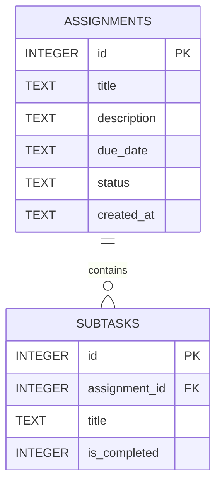

# DeadlineOS — Entity Relationship Diagram

## Overview

DeadlineOS uses SQLite to store assignments and their subtasks. Each assignment can have zero or more subtasks, and each subtask belongs to exactly one assignment.

## ER Diagram

## Relationships

- `assignments.id` is the primary key of the `assignments` table.
- `subtasks.id` is the primary key of the `subtasks` table.
- `subtasks.assignment_id` references `assignments.id`.
- One assignment may have zero or many subtasks.
- Each subtask must reference an existing assignment.
- Deleting an assignment automatically deletes its associated subtasks through `ON DELETE CASCADE`.

## Constraints and Defaults

### Assignments

- `title` is required.
- `description` and `due_date` are optional.
- `status` is required, defaults to `pending`, and accepts `pending`, `in_progress`, or `completed`.
- `created_at` is required and defaults to `CURRENT_TIMESTAMP`.

### Subtasks

- `assignment_id` and `title` are required.
- `is_completed` defaults to `0`.
- `is_completed` accepts only `0` or `1`.
- Foreign-key enforcement is enabled for each database connection.

## Design Notes

- The current schema supports a single-student MVP without user accounts.
- Courses and assignment categories are not separate entities in the current schema.
- Due dates are stored as text; the application should validate their format consistently.
